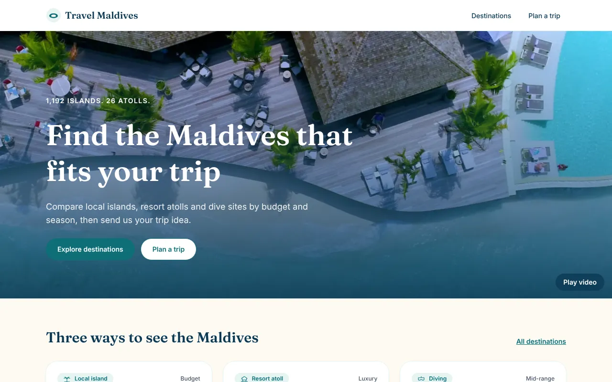
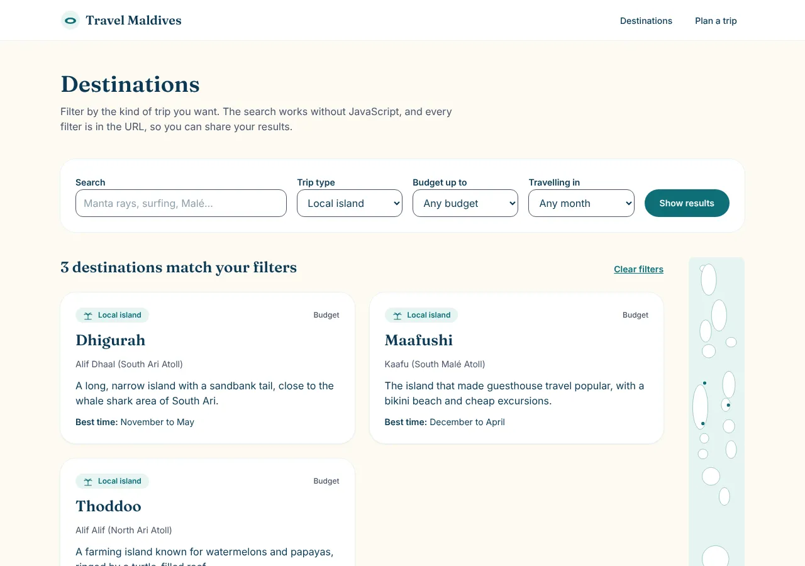
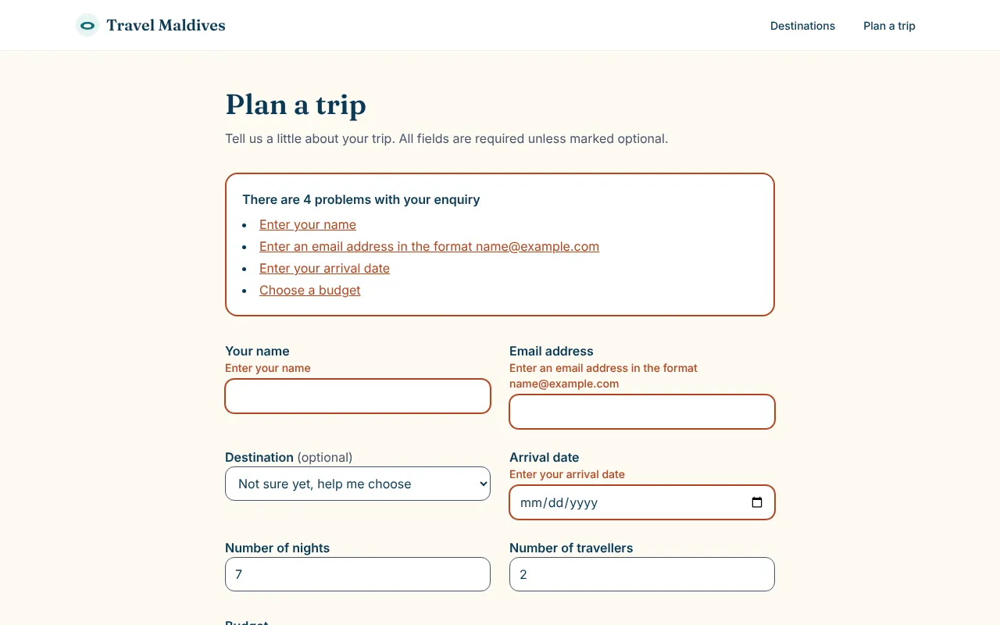
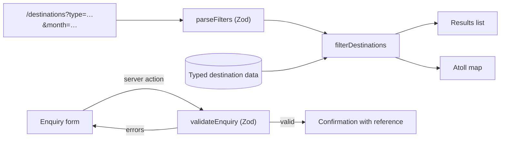

# Travel Maldives

**An accessible Maldives trip planner built with Next.js, TypeScript and React Server Components.**

[](https://github.com/Shani67/Travel-Maldives/actions/workflows/ci.yml)

Compare local islands, resort atolls and dive sites by budget and season, see them on an atoll map, then send a trip enquiry. The search and the enquiry form work with JavaScript turned off, and every page is tested against WCAG 2.2 AA.

> **Live demo:** _add your Vercel URL here_

| Home                                                      | Destinations                                                                  | Enquiry errors                                                      |
| --------------------------------------------------------- | ----------------------------------------------------------------------------- | ------------------------------------------------------------------- |
|  |  |  |

## Features

- **Search and filters in the URL:** a plain GET form filters by text, trip type, budget and month. Results can be shared and bookmarked, and work without JavaScript.
- **Validated with Zod:** filters from the URL and enquiries from the form go through the same kind of schema. Bad input is rejected with clear messages, never a crash.
- **Enquiry form with a server action:** React 19 `useActionState`, progressive enhancement, and an error summary that takes focus and links to each field.
- **Accessible media:** the hero video is re-encoded from 125 MB to 1.7 MB, has a pause button, and never autoplays for people who prefer reduced motion.
- **Atoll map:** a schematic SVG drawn from coordinates, with a text alternative and a caption.
- **Static where it can be:** every destination page is pre-rendered with `generateStaticParams`. Only the filtered list and the form run on the server per request.
- **Technical SEO:** canonical URLs, `sitemap.xml`, `robots.txt`, and schema.org `TouristDestination` with coordinates and `BreadcrumbList`.

## Accessibility

| Area       | What it does                                                                                                                               |
| ---------- | ------------------------------------------------------------------------------------------------------------------------------------------ |
| Forms      | Labels on every field, fieldsets and legends for groups, `aria-invalid` and `aria-describedby` on errors, focus moves to the error summary |
| Media      | Pause control and reduced-motion support (WCAG 2.2.2)                                                                                      |
| Navigation | Skip link, landmarks, breadcrumbs, `aria-current`, visible focus styles                                                                    |
| Colour     | All text meets AA contrast on the sand background                                                                                          |
| Testing    | axe-core scans every page type and the form's error state on desktop and mobile                                                            |

## How it works



### Key decisions

| Decision                                          | Why                                                                              |
| ------------------------------------------------- | -------------------------------------------------------------------------------- |
| GET form instead of client-side filtering state   | Works without JavaScript, shareable URLs, nothing to sync                        |
| Invalid URL params are dropped, not errors        | Anyone can type into a URL; the page should still work                           |
| One Zod schema per input, tested in isolation     | Business rules (no past dates, allowed values) are unit tested without a browser |
| `todayInMaldives()` instead of the server's clock | Arrival-date checks use the destination's time zone (UTC+5)                      |
| Schematic SVG map instead of a map library        | No API key, no extra JavaScript, fully styleable and accessible                  |

## Tech stack

Next.js 16 (App Router, Server Components, Server Actions) · React 19 · TypeScript (strict) · Tailwind CSS 4 · Zod · Vitest · Testing Library · Playwright · axe-core · GitHub Actions · Vercel

## Getting started

Requires Node 22.

```bash
npm install
npm run dev     # http://localhost:3000
```

Set `NEXT_PUBLIC_SITE_URL` to your deployed URL so canonical links and the sitemap use it.

## Quality checks

| Command             | What it runs                                                                                                                                    |
| ------------------- | ----------------------------------------------------------------------------------------------------------------------------------------------- |
| `npm run lint`      | ESLint with Next.js Core Web Vitals rules                                                                                                       |
| `npm run typecheck` | TypeScript in strict mode                                                                                                                       |
| `npm test`          | Vitest: filters, month ranges, enquiry validation, dates                                                                                        |
| `npm run test:e2e`  | Playwright on desktop and mobile: search, enquiry (also without JavaScript), reduced motion, 404, SEO and axe scans (run `npm run build` first) |

GitHub Actions runs all of these on every pull request.

## Project structure

```
src/
  app/                  routes: home, destinations, destination detail, plan (server action), sitemap, robots
  components/           hero video, atoll map, destination cards, enquiry form
  lib/destinations/     typed data, Zod filters, month ranges
  lib/enquiry/          enquiry schema and form parsing
e2e/                    Playwright tests
```

## Roadmap

- [ ] Send enquiries to an email service or CRM
- [ ] Photo galleries for each destination
- [ ] Dhivehi translation with right-to-left layout

## Credits

Hero video: drone footage from the original version of this project. Destination details are summarised for a portfolio demo; check transfers and seasons before booking.

Built by **Geethma Ranathunga**, Senior Frontend / Full Stack Developer. [Portfolio](https://geethma-ranathunga.vercel.app) · [LinkedIn](https://linkedin.com/in/geethma-malshani)
